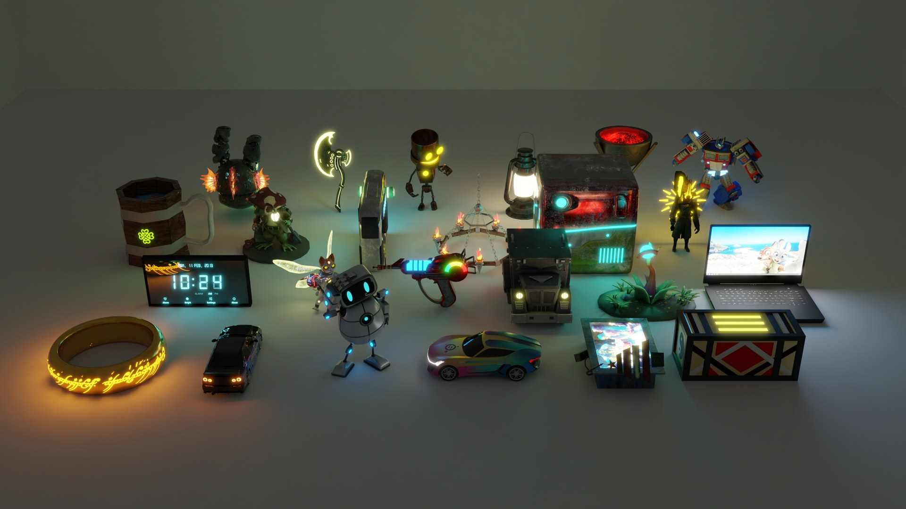

# LightGenBench: A Benchmark for 3D Emission Generation



[Dongchen Yang](https://www.sfu.ca/~dya78/), [Xingguang Yan](https://yanxg.art/), [Manolis Savva](https://msavva.github.io/) \
Simon Fraser University

[](https://3dlg-hcvc.github.io/lightgenbench/)
[](#)
[](https://huggingface.co/datasets/3dlg-hcvc/LightgenBench)

LightGenBench is a benchmark for emission generation.
We curate a [dataset](#dataset-setup) of 36,826 artist-made emissive assets in 105 categories from [TexVerse](https://huggingface.co/datasets/YiboZhang2001/TexVerse), and evaluate [baselines](#baselines) from four method families: UV-domain, sparse-voxel, multi-view, and segmentation-based generation.


## Environment Setup
Clone the repository and create the environment:
```bash
# Clone the repository
git clone https://github.com/3dlg-hcvc/lightgenbench.git
cd lightgenbench

# Create and activate the environment for the evaluation and the dataset build
conda env create -f environment.yml
conda activate lightgen

# Only to score Hunyuan3D-Emission: nvdiffrast, built with a CUDA 12 toolkit
pip install --no-build-isolation git+https://github.com/NVlabs/nvdiffrast.git@v0.4.0
```
Each baseline is a git submodule with its own environment.
Fetch the ones you use and follow their READMEs:
```bash
git submodule update --init TEXGen-Emission   # or TRELLIS.2-Emission, Hunyuan3D-Emission, SegviGen-Emission
```


## Dataset Setup

### 1. Download LightGenBench
First, agree to the terms and request access on [Hugging Face](https://huggingface.co/datasets/3dlg-hcvc/LightgenBench).
Then log in and download the dataset (about 130 GB) into `data/lightgenbench`:
```bash
hf auth login
hf download 3dlg-hcvc/LightgenBench --repo-type dataset --local-dir data/lightgenbench

# Unpack every tar in place
(cd data/lightgenbench && for t in data/*/*/*.tar; do tar -xf "$t"; done)
```


### 2. Download the Test Shapes' Source GLBs
The evaluation reads each test shape's original GLB from [TexVerse](https://huggingface.co/datasets/YiboZhang2001/TexVerse), which the dataset does not include.
This downloads them and writes the index the evaluation finds them through, `data/texverse_index.parquet`:
```bash
python -m data_processing.metadata_filtering.download_texverse --split test
```
To build the dataset yourself instead, see [Build the Dataset Yourself](#build-the-dataset-yourself-optional).


## Baselines
| Baseline | Method family | Built on | Checkpoint |
|---|---|---|---|
| [TEXGen-Emission](https://github.com/dongchen-yang/TEXGen-Emission) | UV-domain | [TEXGen](https://github.com/CVMI-Lab/TEXGen) | coming soon |
| [TRELLIS.2-Emission](https://github.com/3dlg-hcvc/TRELLIS.2-Emission) | sparse-voxel | [TRELLIS.2](https://github.com/microsoft/TRELLIS.2) | coming soon |
| [Hunyuan3D-Emission](https://github.com/dongchen-yang/Hunyuan3D-Emission) | multi-view | [Hunyuan3D-2.1](https://github.com/Tencent-Hunyuan/Hunyuan3D-2.1) | coming soon |
| [SegviGen-Emission](https://github.com/3dlg-hcvc/SegviGen-Emission) | segmentation-based (on voxels) | [SegviGen](https://github.com/Nelipot-Lee/SegviGen) | coming soon |

Our checkpoints will be in the Hugging Face repo `3dlg-hcvc/LightgenBench-baselines`, one folder per baseline.
Each baseline's README covers its setup, training, and prediction with your checkpoint or ours.


## Evaluation
Score a folder of predictions on the test split:
```bash
python -m evaluation.pointsampled.pipeline --pred_root <predictions> --pred_format atlas \
    --dataset_root data/lightgenbench --split test \
    --metadata data/texverse_index.parquet --glb_root data/TexVerse-1K --output_dir <out>
```
Use `--pred_format voxels` for TRELLIS.2-Emission and SegviGen-Emission, and `atlas` for TEXGen-Emission.
The scores go to `<out>/summary_eval.json`, and per shape to `<out>/pointsampled_eval.parquet`.

Hunyuan3D-Emission predicts six views per shape. Turn them into atlases first (on a GPU, with nvdiffrast installed), then score them as `atlas`:
```bash
python -m evaluation.converters.multiview --mode pred --blacken_bg --views_root <views> --out_dir <atlases> \
    --dataset_root data/lightgenbench --split test --metadata data/texverse_index.parquet --glb_root data/TexVerse-1K
```


## Quick Start: Evaluate a Baseline
Run TRELLIS.2-Emission on the two test shapes in `data/lightgenbench_sample/` and score its predictions, without downloading the dataset.
Set up its `trellis2` environment first, as [its README](https://github.com/3dlg-hcvc/TRELLIS.2-Emission) says.
```bash
# Prepare the sample and compute its latents (trellis2 environment)
cd TRELLIS.2-Emission
SKIP_DOWNLOAD=1 SPLITS_SHA256=$(sha256sum ../data/lightgenbench_sample/splits.json | cut -d' ' -f1) \
    bash script/lightgenbench/prepare_lightgenbench.sh ../data/lightgenbench_sample <data_root>
NUM_GPUS=1 bash script/lightgenbench/run_chain.sh latents <data_root>

# Download our checkpoints (coming soon) and predict the emission of the two shapes
hf download 3dlg-hcvc/LightgenBench-baselines --include "TRELLIS.2-Emission/*" --local-dir checkpoints
NUM_GPUS=1 VAE_CKPT=checkpoints/TRELLIS.2-Emission/vae/ckpts/vae.ckpt DIT_CKPT=checkpoints/TRELLIS.2-Emission/dit/ckpts/dit.ckpt \
    bash script/lightgenbench/run_chain.sh predict <data_root>
cd ..

# Score the predictions (lightgen environment)
python -m evaluation.pointsampled.pipeline --pred_root TRELLIS.2-Emission/outputs/predict_test_seed0/pred_voxels \
    --pred_format voxels --dataset_root data/lightgenbench_sample --split test \
    --metadata data/lightgenbench_sample/glb_metadata.parquet --glb_root data/lightgenbench_sample --output_dir <out>
```


## Build the Dataset Yourself (Optional)
To rebuild the dataset, first download the original TexVerse: all GLBs and the thumbnails (over 10 TB):
```bash
for f in TexVerse_id_list.txt thumbnails/thumbnails_part_00 thumbnails/thumbnails_part_01 thumbnails/thumbnails_part_02; do
  hf download YiboZhang2001/TexVerse $f --repo-type dataset --revision a4fe9f473d6628e06c7187604a01c0d8b13de5e2 --local-dir data/TexVerse
done
cat data/TexVerse/thumbnails/thumbnails_part_0{0,1,2} > data/TexVerse/thumbnails/thumbnails.zip
unzip -q data/TexVerse/thumbnails/thumbnails.zip -d data/TexVerse/thumbnails
hf download YiboZhang2001/TexVerse-1K --repo-type dataset --revision 8b4bf4a6eb0c3b3ce5244a863621d79b4d3f344d --local-dir data/TexVerse-1K
```

Then run the build (it uses the `lightgen` and `trellis2` environments and a GPU):
```bash
# Rebuild the released dataset and split
bash data_processing/run_all.sh --out <dir> --pins-from data/lightgenbench/splits.json

# Or judge the shapes with the VLM again (calls the OpenAI API; key in api_key/key.config or OPENAI_API_KEY)
bash data_processing/run_all.sh --out <dir> --vlm
```
See `bash data_processing/run_all.sh -h` to run single stages or to split the run over many machines.


## License
The code in this repository is released under the [MIT license](LICENSE).
Each baseline keeps the license of the method it is built on (see its README).
The dataset's shapes keep the licenses of their source models (see the [dataset card](https://huggingface.co/datasets/3dlg-hcvc/LightgenBench)).
The two shapes in `data/lightgenbench_sample/` are under [CC BY 4.0](https://creativecommons.org/licenses/by/4.0/): the lamp by [Drakahn Finlay](https://sketchfab.com/3d-models/7f3b25f2c5b04d80937d9bdecd484926) and the car by [Artifacts Hub 3d](https://sketchfab.com/3d-models/4db27dca57b64d6f82498b42f0c8b4f8).


## Citation
```
@inproceedings{lightgenbench2026,
  title  = {LightGenBench: A Benchmark for 3D Emission Generation},
  author = {Yang, Dongchen and Yan, Xingguang and Savva, Manolis},
  year   = {2026}
}
```


## Acknowledgments
To be added.
